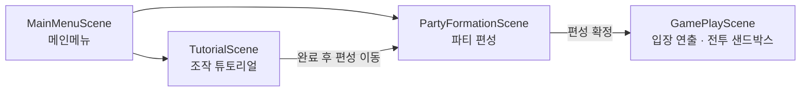
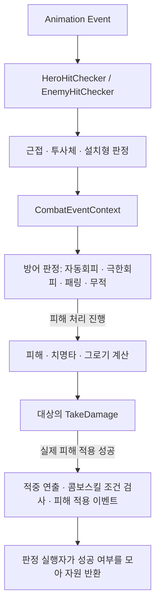

# 3D Action Combat System — ZZZ Recreation Project

Unity 6로 **Zenless Zone Zero의 전투 흐름을 분석하고 재구현한 개인 3D 액션 게임 포트폴리오**입니다.

3명의 캐릭터를 교대하며 기본공격·강화 특수스킬·궁극기, 극한회피·패링지원, 빠른지원과 콤보스킬을 연결합니다. 공통 전투 시스템 위에 캐릭터별 기믹과 적의 행동 선택을 구성하고, 메인메뉴부터 파티 편성·튜토리얼·전투 샌드박스까지 이어지는 플레이 흐름을 구현했습니다.

> 이 저장소는 **C# 소스 코드와 구조 검토를 위한 공개본**입니다. 씬·프리팹·Animator·Timeline·전투 데이터 에셋과 외부 리소스는 포함하지 않으므로, 내려받은 상태에서 원본 게임플레이를 실행할 수 없습니다. 아래 설명은 원본 개발 프로젝트의 구현을 소개하며, 코드 링크는 이 공개 저장소의 파일을 가리킵니다.

| 항목 | 내용 |
|---|---|
| 개발 형태 | 개인 프로젝트 |
| 엔진 / 언어 | Unity `6000.3.13f1` / C# |
| 렌더링 | Universal Render Pipeline `17.3.0` |
| 주요 패키지 | Cinemachine `3.1.6`, Input System `1.19.0`, Timeline `1.8.12` |
| 캐릭터 / 적 | Maria · Erika · Eve / Mutant · Berserker |
| 소스 갱신 기준 | 2026-11-05 |
| 공개 소스 범위 | `Assets/01_Scripts` — `Scrapped_Scripts` 제외, `Assets/08_InputActions` |

플레이 영상과 별도 포트폴리오 문서 링크는 추후 추가 예정입니다.

## 목차

- [프로젝트 구성과 플레이 흐름](#프로젝트-구성과-플레이-흐름)
- [전투 시스템 설계](#전투-시스템-설계)
- [캐릭터별 구현](#캐릭터별-구현)
- [적 AI와 공격 패턴](#적-ai와-공격-패턴)
- [카메라·VFX·오디오](#카메라vfx오디오)
- [UI·설정·튜토리얼](#ui설정튜토리얼)
- [기본 조작](#기본-조작)
- [코드 구조와 권장 탐색 순서](#코드-구조와-권장-탐색-순서)
- [공개 범위와 열람 안내](#공개-범위와-열람-안내)
- [저작권 및 이용 안내](#저작권-및-이용-안내)

## 프로젝트 구성과 플레이 흐름

원본 개발 프로젝트는 다음 네 씬을 중심으로 구성되어 있습니다.



| 구간 | 구현 내용 | 주요 코드 |
|---|---|---|
| 메인메뉴 | 배경 카메라 순환과 페이드, 설정·종료 확인 팝업, 씬 진입 | [MainMenuController](Assets/01_Scripts/System/MainMenuController.cs) |
| 파티 편성 | 캐릭터 선택·해제, 편성 순서와 모델 배치 동기화, 확정 프리팹 목록 전달 | [PartyFormationController](Assets/01_Scripts/System/PartyFormationController.cs) |
| 전투 초기화 | 선택한 프리팹 생성, 파티 등록, 첫 캐릭터의 필드 표시와 입장 Timeline 연결 | [CombatPartyInitializer](Assets/01_Scripts/System/CombatPartyInitializer.cs), [CombatEntryController](Assets/01_Scripts/System/CombatEntryController.cs) |
| 전투 샌드박스 | Mutant·Berserker 소환과 일괄 제거, 무적·에너지 무한·데시벨 무한 옵션 | [CombatSandboxController](Assets/01_Scripts/System/CombatSandboxController.cs) |
| 세션 전환 | 메인메뉴 복귀, 편성에서 전투로 이동, 설정창 정리와 게임 종료 | [GameSessionController](Assets/01_Scripts/System/GameSessionController.cs) |

편성 화면은 **프리팹과 순서만 확정**하고, 전투 씬에서 실제 Hero를 생성합니다. 화면에 표시하는 모델과 전투에서 사용하는 인스턴스의 생명주기를 분리했습니다.

## 전투 시스템 설계

### 1. Hero 상태와 캐릭터 전용 기믹

[Hero](Assets/01_Scripts/Hero/Hero.cs)가 상태 전환을 소유하고, 이동·애니메이션·타격·자원·교대 처리는 각 컴포넌트에 나눴습니다.

| 책임 | 담당 코드 |
|---|---|
| 상태 전환과 입력에 대한 행동 결정 | `Hero` |
| 콤보 예약, 캔슬 구간, 무적 및 행동 플래그 | [HeroActionRegistry](Assets/01_Scripts/Hero/HeroActionRegistry.cs) |
| 이동·회전·회피·중력·공격 중 접근 보정 | [HeroMovement](Assets/01_Scripts/Hero/HeroMovement.cs) |
| Animator 제어와 프레임별 이벤트 수신 | [HeroAnimation](Assets/01_Scripts/Hero/HeroAnimation.cs), [HeroAnimationEventHandler](Assets/01_Scripts/Hero/HeroAnimationEventHandler.cs) |
| 체력·에너지·데시벨·버프 | [HeroStatus](Assets/01_Scripts/Hero/HeroStatus.cs), [Buff](Assets/01_Scripts/Utility/Buff.cs) |
| 일반·강화 특수스킬의 자원 및 연계 | [HeroSkillSystem](Assets/01_Scripts/Hero/HeroSkillSystem.cs) |
| 캐릭터 전용 상태 처리와 자원 | [IHeroMechanic](Assets/01_Scripts/Utility/Interfaces.cs) 구현체 |

상태에는 이동, 기본공격·차지공격·스킬·궁극기, 회피·반격, 교대·지원·콤보스킬, 피격·사망뿐 아니라 입장·오프필드 대기·여진 공격도 포함됩니다.

캐릭터 전용 기믹은 `IHeroMechanic`의 상태 진입·갱신·종료 호출을 통해 공통 FSM에 참여합니다. 상태 자체는 `Hero`가 유지하며, 전용 기믹은 별도 FSM을 중복 실행하지 않습니다. Animation Event로 콤보 입력 구간, 타격 프레임, 이동 구간, 후딜 캔슬 시점을 연결합니다.

### 2. 모션과 타격 데이터를 분리한 공격 구조

[HeroCombatDataSO](Assets/01_Scripts/SO/HeroCombatDataSO.cs)는 공격을 **모션 목록 → 모션 안의 타격 목록**으로 표현합니다.

- **모션 데이터:** 판정 반경과 전방 오프셋, 이동 배율, 설치형 프리팹·사거리·첫 타격 지연.
- **타격 데이터:** 피해·그로기 계수, 판정 방식, 피격 종류와 방향, 타격 간격, VFX·적중음, 에너지·데시벨 반환량, 그로기 연장과 콤보스킬 유발 여부.
- **공격별 시퀀스:** 기본공격, 차지공격과 막타, 대시공격, 일반·강화 특수스킬, 궁극기, 회피·패링 반격, 빠른지원, 콤보스킬, 여진.

[HeroHitChecker](Assets/01_Scripts/Hero/HeroHitChecker.cs)가 모션·타격 인덱스로 데이터를 읽고, 다음 세 판정 경로 중 하나를 실행합니다.

| 판정 방식 | 실행 방식 | 주요 코드 |
|---|---|---|
| `MeleeOverlap` | 타격 프레임의 범위 안에서 대상을 찾고 무기 위치·궤적을 이용해 타격 공간 정보를 계산 | [MeleeHitDetector](Assets/01_Scripts/Utility/Hit%20System/Detection/MeleeHitDetector.cs) |
| `ProjectileCollision` | 발사 시 공격 정보를 전달하고, 충돌 시 단일 피해 또는 반경 기반 폭발 피해 처리 | [ProjectileLauncher](Assets/01_Scripts/Utility/Hit%20System/Projectile/ProjectileLauncher.cs), [ProjectileController](Assets/01_Scripts/Utility/Hit%20System/Projectile/ProjectileController.cs) |
| `PlacedArea` | 위치를 확정한 뒤 첫 타격 지연과 타격 간격으로 구성한 일정에 따라 범위 공격 실행 | [AreaHitDetector](Assets/01_Scripts/Utility/Hit%20System/Detection/AreaHitDetector.cs), [PlacedAreaController](Assets/01_Scripts/Utility/Hit%20System/PlacedArea/PlacedAreaController.cs) |

투사체와 설치형 공격은 발사·생성 당시의 공격 종류와 계수를 [CombatEventContext](Assets/01_Scripts/Utility/CombatEventArgs.cs)에 보관합니다. 이후 캐릭터가 다른 동작으로 전환해도 적중을 현재 동작의 공격으로 해석하지 않습니다. 최종 피해 계산에 사용하는 공격자의 스탯은 적중 처리 시 조회합니다.

설치형 다단히트는 타격마다 독립된 Context를 사용합니다. 프레임이 늦어지면 실행 시간이 지난 타격을 순서대로 처리하고, 마지막 타격 이후 남은 파티클 연출까지 정리한 뒤 풀로 반환합니다.

### 3. 공통 피해 처리와 성공 단위 분리

Hero와 Enemy는 `IAttacker`, `IDamageable`, `IStatus` 계약으로 연결되며, [CombatManager](Assets/01_Scripts/Manager/CombatManager.cs)가 공통 피해 처리를 담당합니다.



**대상별 피해 성공과 한 번의 타격 판정 성공을 구분**합니다. 여러 적을 동시에 맞히더라도 자원 반환과 캐릭터 기믹의 타격 성공 알림은 판정 단위로 한 번 처리합니다. 같은 타격의 적중음도 최초 재생 요청이 수락된 뒤에는 중복 요청하지 않습니다.

실제 피해가 적용되지 않으면 피해 숫자·적중 VFX·자원 반환 등의 성공 처리를 진행하지 않습니다. 공격 동작음, 투사체 발사 연출, 설치·발동 연출은 적중 성공과 별도로 처리합니다.

### 4. 회피·패링지원·빠른지원·교대

| 기능 | 핵심 처리 |
|---|---|
| 극한회피 | 적이 연 방어 구간과 실제 피격 시점의 회피 상태를 검사하고, 같은 공격 기회의 중복 성공을 제한합니다. 성공 시 반격 대상과 회피 반격 가능 상태를 설정합니다. |
| 패링지원 | 교대할 Hero와 공격자를 묶어 요청을 수락하고, 해당 공격자의 실제 타격이 도착했을 때 Parry Impact 성공을 확정합니다. |
| 일반 교대 | 등장 위치를 먼저 검사하고, 퇴장·등장·입력·카메라·현재 Hero를 전환합니다. 퇴장 동작과 디더가 끝나면 표시와 CharacterController를 정리합니다. |
| 빠른지원 | 넉백 피격 또는 지정된 공격 이벤트로 지원 창을 열고, 지원 캐릭터·대상·방향·세션 ID를 보관합니다. 실행 시 유효성을 다시 확인합니다. |
| 오프필드 동작 | 교대 직후 잔여 공격이나 여진 동작을 유지하는 상태를 별도로 관리합니다. 조작 캐릭터와 필드에 남아 동작하는 캐릭터를 구분합니다. |
| 사망 교대 | 생존 파티원을 탐색해 조작 대상을 넘기고, 전멸하면 파티 패배 상태를 알립니다. |

[PartyStateManager](Assets/01_Scripts/Manager/PartyStateManager.cs)는 파티와 현재 Hero, [PartySwapManager](Assets/01_Scripts/Manager/PartySwapManager.cs)는 교대 실행, [HeroSwapSystem](Assets/01_Scripts/Hero/HeroSwapSystem.cs)은 캐릭터별 등장·퇴장을 맡습니다. [QuickAssistManager](Assets/01_Scripts/Manager/QuickAssistManager.cs)는 지원 창과 실행 정보를 관리합니다.

빠른지원의 이전 실행 결과가 새 지원 창을 닫지 않도록 완료 시 세션 ID를 대조합니다. 패링도 요청 수락과 성공을 분리하여, 교대했다는 이유만으로 반격 성공 상태가 되지 않도록 구성했습니다.

### 5. 그로기와 콤보스킬 QTE

[EnemyGroggy](Assets/01_Scripts/Enemy/EnemyGroggy.cs)는 그로기 누적, 지속시간·연장, 종료와 콤보스킬 기회를 관리합니다.

**게이지가 가득 찬 것만으로 QTE가 열리지는 않습니다.** 현재 조작 Hero가 그로기 상태의 생존 적에게 `canTriggerChainAttack`이 설정된 타격을 적용하면 개방 조건을 검사합니다. 적 등급·생존 파티 인원·남은 기회와 선택 가능한 후보를 함께 확인합니다.

[ChainAttackManager](Assets/01_Scripts/Manager/ChainAttackManager.cs)는 `Inactive → Selecting → Executing` 단계로 선택과 실행을 구분합니다. 선택 중에는 전용 입력 맵·카메라·시간 배율을 사용하고, 선택된 캐릭터의 교대는 `PartySwapManager`에 요청합니다. 실행 중 그로기가 끝나면 현재 동작은 마치되 추가 QTE를 제한합니다.

### 6. 타깃 선택과 이동 보정

[LockOnManager](Assets/01_Scripts/Manager/LockOnManager.cs)는 이동 입력 방향을 고려하는 Soft Lock과 화면상 대상 선택·전환을 사용하는 Hard Lock을 구분합니다. 대상 사망과 유지 거리 이탈을 처리하고, 회피·패링 반격에서는 성공한 공격자를 반격 대상으로 연결합니다.

`HeroMovement`는 CharacterController로 이동과 중력을 처리합니다. 공격 이동은 Animation Event가 허용한 구간에서 실행하며, 대상 추적·고정 방향·캐릭터 로컬 방향과 모션별 배율을 사용합니다. 일반 교대의 등장 위치, Erika 여진의 등장 위치, 투사체 생성 위치에는 각각 공간·지형 검사 경로를 두었습니다.

## 캐릭터별 구현

세 캐릭터는 공통 Hero·전투 데이터 구조를 사용하면서 공격 구성과 전용 기믹을 다르게 조합합니다.

| 캐릭터 | 원본 프로젝트의 공격 구성 | 전용 구현 |
|---|---|---|
| **Maria** | 근접 연속공격, 반복 강화 특수스킬과 막타, 다단히트 궁극기 | 실제 스킬 에너지 소비를 전용 게이지로 전환하는 **Blazing** 강화 |
| **Erika** | 투사체와 근접을 혼합한 연계, 반복 차지공격, 설치형 궁극기 | 차지공격 중 **자동회피**, 전용 자원을 사용하는 오프필드 **AfterShock** |
| **Eve** | 기본·차지 투사체, 설치형 스킬·반격·궁극기 | 개별 공격 클립을 공통 판정에 연결하고 **패링 방벽**과 궁극기 빠른지원 처리 |

- [MariaMechanic](Assets/01_Scripts/HeroSpecific/Maria/MariaMechanic.cs): 게이지가 남아 있으면 공격력·치명타 관련 버프를 유지합니다. 온필드에서 시간에 따라 게이지를 소비하고 교대 중에는 보존하며, 궁극기 진입 시 충전합니다. 강화 상태를 무기 불꽃과 전용 SFX에도 연결합니다.
- [ErikaMechanic](Assets/01_Scripts/HeroSpecific/Erika/ErikaMechanic.cs): 차지공격 적중과 강화 특수스킬 이벤트로 자원을 얻습니다. 오프필드 대기 중 자원·쿨타임·유효 대상·등장 위치를 확인해 여진을 시작하고 첫 실행 프레임에 자원을 소비합니다. 차지공격은 반복·자동회피·막타 단계를 구분하며, 자동회피 후 입력 유지 여부에 따라 반복 또는 막타로 이어집니다.
- [EveMechanic](Assets/01_Scripts/HeroSpecific/Eve/EveMechanic.cs): 현재 재생 클립을 확인해 타격·콤보 예약·후딜 캔슬 이벤트를 전달합니다. 패링 준비·성공·종료에 맞춰 방벽을 제어하고, 궁극기의 지정 이벤트에서 빠른지원 창을 요청합니다. 현재 구현에는 별도 전용 자원 게이지가 없습니다.

캐릭터별 수치와 공격 배치는 원본의 CombatData·프리팹에 저장됩니다. 공개본의 SO 클래스는 데이터 구조를 보여주며, 실제 `.asset` 값은 포함하지 않습니다.

## 적 AI와 공격 패턴

적의 행동은 **감지 → 판단 → 행동 트리 → Enemy 상태 실행**으로 나눴습니다.

| 계층 | 책임 |
|---|---|
| [EnemySensor](Assets/01_Scripts/Enemy/EnemySensor.cs) / Blackboard | 대상과 거리 등 판단에 필요한 정보 갱신 |
| [EnemyDecision](Assets/01_Scripts/Enemy/EnemyDecision.cs) | 추격·주변 이동 범위와 공격 가능 여부 판단. 진입·이탈 거리를 구분해 경계에서 판단이 반복 전환되는 현상을 줄임 |
| [EnemyAI](Assets/01_Scripts/Enemy/EnemyAI.cs) / [EnemyBT](Assets/01_Scripts/Enemy/EnemyBT.cs) | 공통 갱신과 Selector·Sequence·Condition·Action 실행 |
| [EnemyPattern](Assets/01_Scripts/Enemy/EnemyPattern.cs) | 사거리와 쿨타임을 통과한 후보의 가중치 기반 선택 |
| [Enemy](Assets/01_Scripts/Enemy/Enemy.cs) | 선택된 공격, 추격·대기·주변 이동, 피격·그로기·사망 상태 실행 |

[MutantAI](Assets/01_Scripts/EnemySpecific/Mutant/MutantAI.cs)와 [BerserkerAI](Assets/01_Scripts/EnemySpecific/Berserker/BerserkerAI.cs)는 현재 공통 우선순위인 **공격 → 전투 대기 → 주변 이동 → 추격 → 기본 대기**로 트리를 구성합니다. 두 적의 차이는 연결된 패턴·전투 데이터와 애니메이션 구성에 있습니다. 원본 프리팹에는 Mutant의 Slash·JumpAttack, Berserker의 Combo A–E·QuickSwing A/B·JumpAttack이 연결되어 있습니다.

패턴 선택은 최고 점수 하나를 고정 선택하는 방식이 아닙니다. 기본 선호도, 거리 적합도 곡선, 직전·최근 사용 이력 감점을 곱한 값을 **확률 가중치**로 사용합니다. 개별 패턴 쿨타임과 공통 쿨타임도 별도로 적용합니다.

[EnemyPatternDataSO](Assets/01_Scripts/SO/EnemyPatternDataSO.cs)는 선택 조건·Animator Trigger·슈퍼아머·CombatData 참조를, [EnemyCombatDataSO](Assets/01_Scripts/SO/EnemyCombatDataSO.cs)는 모션별 타격 데이터를 보관합니다. [EnemyHitReaction](Assets/01_Scripts/Enemy/EnemyHitReaction.cs)은 기본 저항과 패턴 중 슈퍼아머를 조합해 피격 반응을 결정합니다.

AI는 일반 전투, 공격하지 않는 `Passive`, 제자리에 머무는 `Stationary` 모드를 지원하며 튜토리얼에서도 활용합니다.

## 카메라·VFX·오디오

### 카메라와 전투 연출

[CombatPresentationManager](Assets/01_Scripts/Manager/CombatPresentationManager.cs)는 궁극기·패링·극한회피·콤보스킬 선택의 연출을 관리합니다.

- **궁극기:** 캐릭터별 Timeline·Cinemachine 카메라 바인딩, 월드 감속과 시전자 애니메이션 배속 보정, 전용 조명·배경·렌더링 레이어 제어.
- **Timeline Signal:** 시간 복원, 궁극기 카메라 해제, 원래 레이어와 배경 복귀 시점을 분리.
- **방어 연출:** 패링 전용 카메라와 임팩트, 극한회피 슬로우 모션·비네트·효과음.
- **타격 반응:** Hit Stop과 Cinemachine Impulse. 근접 적중, 투사체 발사, 설치형 발동의 요청 시점을 구분.
- **복원 처리:** 정상 종료뿐 아니라 시전자 상태 이탈·비활성화 등의 중단 경로에서도 시간·카메라·렌더링 상태 정리.

입장 연출은 [EntryCameraHandoff](Assets/01_Scripts/System/EntryCameraHandoff.cs)가 Hero 기준의 Timeline 구도를 월드 위치로 보정하고 Gameplay 카메라에 연결합니다.

### VFX와 오브젝트 재사용

[VFXManager](Assets/01_Scripts/Manager/VFXManager.cs)와 [ParticleVFXManager](Assets/01_Scripts/Manager/ParticleVFXManager.cs)는 타격 임팩트·흔적·스파크·공격 연출을 관리합니다. 타격 지점과 표면 법선, 공격 방향을 이용해 연출을 배치하고, 교대 표시에는 [HeroDitherController](Assets/01_Scripts/Hero/HeroDitherController.cs)의 MaterialPropertyBlock 기반 디더를 사용합니다.

투사체와 설치형 공격은 [ProjectilePoolManager](Assets/01_Scripts/Manager/ProjectilePoolManager.cs), [PlacedAreaPoolManager](Assets/01_Scripts/Manager/PlacedAreaPoolManager.cs)의 프리팹별 풀로 재사용합니다. 반환할 때 이전 공격의 Context·충돌·타이머·파티클 상태를 정리합니다.

### 전투 오디오와 BGM

[AudioCueSO](Assets/01_Scripts/SO/AudioCueSO.cs)에 클립 후보, 랜덤·순차 선택, 연속 중복 방지, 볼륨·피치·Mixer Group·공간 음향 설정을 모았습니다.

[AudioManager](Assets/01_Scripts/Manager/AudioManager.cs)는 AudioSource 풀로 일회성 효과음을 재생하고, 반복음은 핸들을 발급해 위치 추적과 반환을 관리합니다. 공통 Hero·Enemy 효과음과 캐릭터별 차징·강화·무기 효과음은 각각의 Audio 컴포넌트에서 요청합니다.

[BGMManager](Assets/01_Scripts/Manager/BGMManager.cs)는 씬 전환 사이에 재생을 유지합니다. 같은 곡을 다시 요청하면 재시작하지 않고, 새 곡은 페이드인합니다.

## UI·설정·튜토리얼

| 영역 | 구현 내용 | 주요 코드 |
|---|---|---|
| 파티 HUD | 현재·대기 캐릭터, 체력·에너지·데시벨, 전용 스택·게이지 표시 | [PartyHUDController](Assets/01_Scripts/UI/PartyHUDController.cs), [HeroMechanicResourceView](Assets/01_Scripts/UI/HeroMechanicResourceView.cs) |
| 전투 커맨드 | 조작 Hero의 스킬·궁극기·회피 상태와 빠른지원 대상 표시 | [CombatCommandHUDController](Assets/01_Scripts/UI/CombatCommandHUDController.cs), [QuickAssistHUDView](Assets/01_Scripts/UI/QuickAssistHUDView.cs) |
| 적 HUD / QTE | 체력·그로기 표시, 콤보스킬 후보·제한시간 UI | [EnemyBillboardController](Assets/01_Scripts/UI/EnemyBillboardController.cs), [ChainQTEController](Assets/01_Scripts/UI/ChainQTEController.cs) |
| 설정 | Master·SFX·BGM 볼륨, 마우스 감도, 해상도, 전체화면·창 모드 | [SettingsManager](Assets/01_Scripts/Manager/SettingsManager.cs), [SettingsUI](Assets/01_Scripts/UI/SettingsUI.cs) |
| 튜토리얼 | 단계별 안내, 목표 판정, 훈련용 적과 파티원 합류, 완료 UI | [TutorialController](Assets/01_Scripts/System/TutorialController.cs) |

설정은 편집 중인 볼륨·감도를 미리 적용하고, 확정 시 화면 설정과 함께 PlayerPrefs에 저장합니다. 미확정 상태로 닫으면 마지막 확정값으로 복원합니다. 전투 중 설정창은 입력·시간·커서를 제어하며, 콤보스킬 선택 및 궁극기 컷신 중에는 열기를 제한합니다.

튜토리얼은 **이동 → 락온 → 기본공격 → 일반스킬 → 강화 특수스킬 → 궁극기 → 정·역방향 교대 → 회피 → 극한회피 → 패링지원 → 콤보스킬** 순서로 진행합니다. 단순 키 입력 대신 목적지 도착, 실제 피해 적용, 교대 실행, 방어 성공 이벤트를 목표 판정에 사용합니다. 공격 종류와 기본공격 모션 번호는 적중 시 전달된 Context로 확인합니다.

## 기본 조작

아래는 [HeroActions.inputactions](Assets/08_InputActions/HeroActions.inputactions)의 키보드·마우스 바인딩과 전투 처리 기준입니다. 공개본 자체의 실행을 의미하지는 않습니다.

| 입력 | 동작 |
|---|---|
| `W A S D` | 이동 |
| 마우스 이동 | 카메라 회전 / Hard Lock 중 좌우 대상 전환 |
| `Left Ctrl` | 걷기 모드 전환 |
| 우클릭 / `Left Shift` | 회피 |
| 좌클릭 / 길게 누르기 | 기본공격·연계 / 차지공격 |
| `E` | 특수스킬 / 에너지 조건을 충족하면 강화 특수스킬 |
| `Q` | 데시벨 조건을 충족하면 궁극기 |
| `Space` / `C` | 정방향 / 역방향 교대. 지원 창과 방어 구간에 따라 빠른지원·패링지원 실행 |
| 휠 클릭 | Hard Lock 켜기·끄기 |
| `Esc` | 설정창 열기·닫기 |

콤보스킬 선택 중에는 전용 `ChainQTE` 입력 맵을 사용합니다.

| 입력 | 동작 |
|---|---|
| 좌클릭 / `C` | 역방향 후보 선택 |
| 우클릭 / `Space` | 정방향 후보 선택 |
| 휠 클릭 | 선택 취소 |

## 코드 구조와 권장 탐색 순서

```text
Assets/
├─ 01_Scripts/
│  ├─ Hero/             # 공통 상태·이동·타격·자원·교대
│  ├─ HeroAnimator/     # 차지공격 종료 StateMachineBehaviour
│  ├─ HeroSpecific/     # Maria·Erika·Eve 전용 기믹과 오디오
│  ├─ Enemy/            # 공통 상태·감지·판단·BT·패턴·그로기
│  ├─ EnemySpecific/    # Mutant·Berserker 행동 트리 구성
│  ├─ Manager/          # 전투·파티·지원·연출·오디오·설정·풀
│  ├─ SO/               # 전투·패턴·오디오·VFX 데이터 형식
│  ├─ System/           # 메뉴·편성·진입·세션·튜토리얼·샌드박스
│  ├─ UI/               # HUD·QTE·설정·튜토리얼 표시
│  ├─ Utility/
│  │  └─ Hit System/    # Detection·Projectile·PlacedArea
│  └─ VFX/              # 임팩트·흔적·궤적·경고 연출
└─ 08_InputActions/
   ├─ HeroActions.inputactions
   └─ HeroActions.cs    # Input System 생성 코드
```

처음 검토할 때는 다음 순서로 읽으면 각 시스템의 연결을 따라갈 수 있습니다.

1. **행동과 확장 지점:** `Hero.ChangeState` → `IHeroMechanic` → `MariaMechanic` / `ErikaMechanic` / `EveMechanic`.
2. **한 번의 공격:** `HeroAnimationEventHandler` → `HeroHitChecker` → 판정 컴포넌트 → `CombatManager.ProcessHit` → `Hero/Enemy.TakeDamage`.
3. **파티 전투:** `PartyStateManager` → `PartySwapManager` → `QuickAssistManager` / `ChainAttackManager` → `HeroSwapSystem`.
4. **적의 의사결정:** `EnemyAI` → `EnemySensor` / `EnemyDecision` → `EnemyPattern` → `EnemyBT` → `Enemy`.
5. **플레이 흐름과 연출:** `PartyFormationController` → `CombatPartyInitializer` → `CombatEntryController`, 이후 `CombatPresentationManager`와 `TutorialController`.

`HeroSpecific/MechanicExample.cs`는 신규 기믹 구현을 위한 예제이며 플레이 캐릭터가 아닙니다. 폐기 코드를 모아 둔 `Scrapped_Scripts`는 공개 대상에서 제외했습니다.

## 공개 범위와 열람 안내

| 포함 | 제외 |
|---|---|
| 공통 전투·캐릭터·적 AI·UI·시스템 C# 코드와 `.meta` | 씬·캐릭터 및 UI 프리팹·Animator Controller·애니메이션 클립 |
| Input Actions 정의와 생성 C# | Timeline과 Signal 에셋, 실제 CombatData·PatternData·AudioCue `.asset` |
| Packages·ProjectSettings 및 일부 URP 설정 | 외부 모델·텍스처·사운드·VFX·폰트 등 리소스 |

**코드 열람은 Clone 또는 ZIP 다운로드 후 IDE에서 진행할 수 있습니다.** 공개된 프로젝트 설정은 참고용이며, 위에서 소개한 최신 개발 씬 구성과 Inspector 연결을 복원하는 자료는 아닙니다. Unity로 열더라도 누락된 에셋 참조와 씬 구성을 별도로 갖춰야 하므로 원본과 동일한 실행·빌드 환경은 제공하지 않습니다.

코드의 필드 초기값과 원본 Inspector의 저장값은 다를 수 있습니다. 공격 수치·애니메이션 이벤트 배치·프리팹 연결을 확인할 때는 공개된 클래스 정의와 원본의 실제 설정을 구분해야 합니다.

## 저작권 및 이용 안내

본 프로젝트는 개인 학습 및 취업 포트폴리오 목적으로 제작된 비상업적 프로젝트이며, Zenless Zone Zero의 공식 프로젝트가 아닙니다. Zenless Zone Zero 및 관련 상표와 원작 콘텐츠의 권리는 각 권리 보유자에게 있습니다.

원본 개발 프로젝트에서 사용하는 Unity Asset Store 및 기타 배포처의 모델·애니메이션·텍스처·사운드·VFX 등 외부 에셋은 이 공개 저장소에 포함하지 않았습니다. 공개본은 직접 작성한 C# 코드와 프로젝트 설정을 중심으로 구성되어 있으며, Input System이 생성한 코드는 해당 경로에 별도 표시했습니다.

본 저장소에는 별도의 오픈소스 라이선스를 부여하지 않습니다. 채용 검토와 개인 학습 목적의 로컬 열람 및 수정은 허용하지만, 작성자의 허가 없는 코드 재배포, 상업적 이용 및 저작자 사칭은 허용하지 않습니다.
